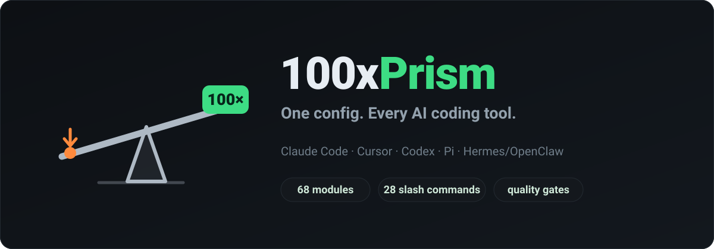

<div align="center">


# 100xPrism

### Stop vibe coding. Ship production-grade software.

[](https://github.com/rajitsaha/100xprism/releases/latest)
[](https://www.npmjs.com/package/100xprism)
[](LICENSE)

**One set of AI coding workflows, rendered natively for Claude Code, Cursor, Codex, Pi and Hermes, with a quality gate before every commit.**



</div>

---

## Quick start

**1. Install (once per machine).**

```bash
# npm — macOS, Linux, Windows (needs Node.js 18+)
npm install -g 100xprism && 100xprism install

# or curl — macOS / Linux
curl -fsSL https://raw.githubusercontent.com/rajitsaha/100xprism/main/get.sh | bash
```

Both clone the toolkit to `~/100xprism`, set up Claude Code, and let you toggle
components (modules, plugins, templates, enforcing hooks).
The npm package is a thin launcher; modules, hooks and plugins live in that clone.
On macOS, an interactive install opens the token dashboard when the first scan
finishes (`--no-open` skips it).

**2. Set up a project (once per repo).**

```bash
cd your-project && 100xprism init
```

`init` asks which tools you use in the repo (Claude Code, Cursor, Codex, Pi) and writes
their files. Commit them so teammates get the same setup on clone.

**3. Use it.** Restart Claude Code, then run:

```
/gate      # run the quality gate
/commit    # gate → stage → conventional commit
```

> **Two places, two kinds of command.** `100xprism …` runs in your **terminal**.
> `/gate`, `/commit` and the other slash commands run **inside your AI tool**.

---

## What you get

| | |
|---|---|
| **68 modules** | 28 slash commands + 40 auto-trigger skills (task-triggered playbooks: marketing, SEO, CRO, design) |
| **Quality gate** | `/gate`: tests ≥ 95% coverage, security, build, plus Docker and cloud checks when they apply |
| **Enforcing hooks** (opt-in) | Block `git commit`/`git push` until `/gate` passes on the current tree; block obvious hard-coded secrets |
| **2 Claude Code plugins** | GitHub and security guidance. Other plugins are listed as recommendations, never installed silently |
| **`/db`** | One interface to 7 engines: Postgres, Cloud SQL, Snowflake, Databricks, Athena, Presto, Oracle |
| **`/connect`** | Install and authenticate 27 SaaS CLIs (GitHub, AWS, Stripe, Supabase, …) from `.env` |
| **4 project templates** | node-fullstack · node-frontend · python-api · docker-compose, copied to `~/100x-templates/` |
| **CI templates** | GitHub Actions: lint, real-DB tests, E2E (`ci.yml`) and tag-triggered publishing (`release.yml`) |
| **Token economics** | A local dashboard of token spend, cost and delivered work across Claude Code, Codex, Cursor, Pi and Antigravity |

---

## Lean by default: what sits in your context

A module's **description** is re-sent to the model on every turn; its **body** loads only
when used. So every installed module costs tokens all the time. 100xPrism installs the
minimum by default:

| Mode | Installed as native skills | Everything else |
|---|---|---|
| **`must`** (default) | 12 core workflows + `100x-resolver` | In a catalog on disk; loaded on demand |
| `profile` | `must` + 18 more: the other 16 slash-command modules, `subagents`, `terminal-setup` | 38 marketing/design playbooks stay in the catalog |
| `all` | All 68 modules | — |

The 12 must-have workflows: `gate` `commit` `push` `branch` `pr` `release` `test` `lint`
`security` `docs` `eval` `pair-loop`.

**Reaching a module that isn't installed.** Use the generic route, or just describe the
task — the always-loaded `100x-resolver` tells the agent where each catalog module lives:

```
/100x spec               # run the spec workflow
/100x fix-bugs "login returns 403"
```

**Changing the mode.** `optimize` writes your choice and re-emits immediately. Run it from
a project root — it also updates that project's generated files.

```bash
100xprism optimize --skills=profile   # every slash command becomes native (/spec, /fix, …)
100xprism optimize --skills=all       # every module installed
100xprism optimize                    # back to must
100xprism optimize --dry-run          # preview without changing anything
```

Estimated always-on description cost (characters ÷ 4, checked in CI — not billed usage):

| Tool | `all` | `profile` | `must` |
|---|---:|---:|---:|
| Claude Code, Pi | ~4,834 | ~1,685 | **~592** |
| Codex | ~4,834 | ~1,666 | **~573** |
| Cursor | ~2,057 | ~821 | **~377** |

Details: [docs/token-optimization.md](docs/token-optimization.md).

---

## Slash commands

All 28, grouped by purpose. ★ = installed natively in the default `must` mode. Run the
others as `/100x <slug>` (slug in brackets where it differs), or switch to
`--skills=profile` to get them all natively.

**Lifecycle**

| Command | What it does |
|:--|:--|
| ★ `/branch` | Create a conventional feature branch (`feat/`, `fix/`, `chore/`) |
| ★ `/commit` | Gate → stage → conventional commit |
| ★ `/pr` | Gate → push branch → open a PR with AI review |
| ★ `/push` | Gate → push → watch CI → check production health |
| ★ `/release patch\|minor\|major` | Bump version, tag, publish to PyPI/npm/Docker Hub, verify |
| ★ `/pair-loop` | Coder ↔ reviewer loop across Claude/Codex/Cursor/Pi, with per-round cost |
| `/grill` [`grill-me`] | Adversarial review before a PR |
| `/launch` | Full deploy pipeline |

**Quality**

| Command | What it does |
|:--|:--|
| ★ `/gate` | Quality gate: tests, security, build, Docker, cloud |
| ★ `/test` | Run every test layer; add tests until coverage ≥ 95% |
| ★ `/lint` | Detect linters/formatters, run them, fix errors |
| ★ `/security` | Dependency vulnerabilities + leaked secrets; fix what's fixable |
| ★ `/eval` | Run a module's evals — does it still trigger and work? |
| `/cloud-security` | Cloud IAM, networking, PII and compliance scan |

**Engineering**

| Command | What it does |
|:--|:--|
| `/spec` | Turn a vague request into an implementation-ready spec |
| `/fix` [`fix-bugs`] | Fix bugs from CI failures, logs, or a description |
| `/orchestrate` | Plan-first method for multi-step tasks |
| `/techdebt` | Find dead code, duplication, stale TODOs |
| `/update-claude` [`update-claude-md`] | Turn a correction into a `CLAUDE.md` rule |
| `/pack` | Install or remove optional vendor skill packs (see below) |

**Data, docs & architecture**

| Command | What it does |
|:--|:--|
| ★ `/docs` | Sync docs with what shipped |
| `/db` | Query any of 7 database engines |
| `/query` [`data-query`] | Plain-English analytics → SQL |
| `/connect` | Install + authenticate SaaS CLIs from `.env` |
| `/context` [`context-dump`] | 7-day git + GitHub activity summary |
| `/issue` | Investigate a bug and file a detailed GitHub issue |
| `/architect` | Architecture Q&A and decision matrices |
| `/enterprise-design` | Full blueprint: IA, API, data model, stack |

**Task-triggered playbooks (40).** No command — describe the task ("audit SEO on this
page") and the agent loads the matching playbook: from the catalog via `100x-resolver`
by default, or as its own skill in `all` mode.

| Area | Modules |
|:--|:--|
| Marketing copy | copywriting, copy-editing, cold-email, email-sequence, ad-creative, social-content |
| SEO | seo-audit, ai-seo, programmatic-seo, schema-markup, site-architecture |
| CRO | page-cro, signup-flow-cro, onboarding-cro, form-cro, popup-cro, paywall-upgrade-cro |
| Growth & strategy | content-strategy, marketing-ideas, marketing-psychology, launch-strategy, referral-program, churn-prevention, free-tool-strategy, ab-test-setup, analytics-tracking, pricing-strategy |
| Sales | sales-enablement, competitor-alternatives, paid-ads, revops, product-marketing-context |
| Design & UX | visual-system-architect, interaction-engineer, figma-translator, motion-designer, data-viz, a11y-auditor |
| Engineering | subagents, terminal-setup |

**In Codex** use skills by name (`$gate`, `$commit`) or pick from `/skills`. **In Pi** use
`/skill:gate`. **In Cursor**, ask for the workflow by name ("run the gate workflow").

---

## How each tool receives the modules

| Tool | Where | What is written |
|:--|:--|:--|
| **Claude Code** | `~/.claude/skills/` (global) | One skill per installed module, `/100x` route, `100x-resolver` |
| **Cursor** | `.cursor/rules/` (per project) | One `.mdc` rule per installed module; `gate` is always-on, the rest load when relevant |
| **Codex** | project root (per project) | Compact `AGENTS.md`, `.agents/skills/`, catalog; hook groups in `.codex/hooks.json` only with `PRISM_HOOKS=1` |
| **Pi** | `.pi/skills/` (per project) or `pi install git:github.com/rajitsaha/100xprism` | Same must-first selection; gate/secret extensions ship but are off by default |
| **Hermes/OpenClaw** | `~/.hermes/skills/100xprism/` (global) | One skill per module, descriptions shortened to fit Hermes's ~57-character index limit |

`install` and `update` run the Hermes adapter automatically when `~/.hermes` or the
`hermes` CLI exists. If you install Hermes later, run `100xprism hermes` (or wait for
your next `100xprism update`).

Claude Code plugins are Claude-only. Use Codex `/plugins` for Codex-native plugins.

**Windows:** `install`, `init` and `update` work natively for Claude Code, Cursor and
Codex. Pi, Hermes, and background token collection need macOS or Linux (WSL works).

---

## Keeping up to date

```bash
100xprism check                   # is a newer version available?
100xprism update                  # pull latest; add, update and remove generated files
npm install -g 100xprism@latest   # (optional) update the launcher itself
```

`update` **reconciles**: it adds new modules and plugins, updates changed ones, and
removes ones that were deleted or merged upstream — in `~/.claude` and in every project
you ran `init` in (listed in `~/.100xprism/tracked-projects`). Restart Claude Code after
updating.

If `~/100xprism` has local changes, `install` and `update` refuse and change nothing.
They list the files and print the `git -C ~/100xprism stash -u` (keep) or reset (discard)
command to run, so there is no need to delete the clone.

**What 100xPrism will and won't delete.** It removes only files it can prove it wrote: a
generated marker, a manifest entry, a `/100xprism/hooks/` path, or an exact v1 file
header. Your own skills, commands, hooks, plugins and a hand-written `AGENTS.md` are
never touched. Files removed from a project are first copied to
`~/.100xprism/removed-artifacts/<timestamp>/`.

**Repairing and removing.**

```bash
100xprism audit                  # report standing context and drift
100xprism audit --fix            # repair dead hook paths, v1 leftovers, missing catalog
100xprism uninstall              # remove skills, aliases, hooks, catalog, links (keeps your data)
100xprism uninstall --projects   # …also generated files in every tracked project
100xprism uninstall --purge      # …also all of ~/.100xprism, including token history
```

Run `100xprism uninstall` **before** `npm rm -g 100xprism`. npm's own uninstall hook only
stops the dashboard and removes hooks that point into the deleted package.

---

## Optional vendor skill packs

Packs are skill sets that matter only to some projects, so they never install by
default. Manage them from inside Claude Code:

```
/pack                    # list packs, install state, and what matches this project
/pack detect             # only packs that match this project
/pack add databricks     # install
/pack remove databricks  # remove only what 100xPrism installed
```

Where the vendor ships an installer (e.g. `databricks aitools install`), the pack uses
it. Available today: **Databricks** (Unity Catalog, Asset Bundles, Lakeflow, model
serving, vector search).

---

## Token, delivery & value economics

Agents spend real money. The dashboard keeps three questions apart: **what did it cost**,
**what was delivered**, and **what was it worth** — the last stays "Not measured" until
you connect an outcome source. It never invents a value score.

```bash
100xprism tokens            # open the local dashboard (http://127.0.0.1:8787)
100xprism tokens --print    # text summary, no server
100xprism tokens --json     # machine-readable report (filter with --tool codex)
100xprism value             # git delivery report for the current directory
```

- **Cost.** Claude Code and Codex record exact token counts locally; cost is priced
  per model from a dated catalog (`scripts/pricing.py`). Pi is counted when its records
  carry token counts. Cursor and Antigravity expose no token counts locally, so they are
  shown as activity only, with cost `—` (never a made-up `$0`).
- **Delivery.** Commits, merged PRs, releases and churn from git, joined to the spend
  that could be attributed to each directory.
- **macOS:** `install` adds a LaunchAgent that collects every minute into a private
  SQLite store (`~/.100xprism/token-economics/`), so history survives deleted
  transcripts. The dashboard needs a per-launch token (the command opens it for you)
  and stops after 10 idle minutes. **Linux/Windows:** reports are computed on demand.
- Nothing starts from your shell. Nothing leaves your machine unless you opt in to
  GitHub PR insights.

Budgets, GitHub insights, content search and every flag:
[docs/USAGE.md › Monitoring token usage](docs/USAGE.md#monitoring-token-usage).

---

## Built with 100xPrism

| Product | Source |
|:--|:--|
| [100xprism](https://github.com/rajitsaha/100xprism) — this toolkit, built with itself | Open source |
|  [agentbreeder](https://github.com/agentbreeder/agentbreeder) | Open source |
|  [hippokit.ai](https://hippokit.ai) | Closed source |
|  [norulestrends.com](https://norulestrends.com) | Closed source |
|  [reinvestiq.com](https://reinvestiq.com) | Closed source |

### What it changed

Snapshot taken **2026-08-02** from each repo's git history.

| From git history | [100xprism](https://github.com/rajitsaha/100xprism) | [agentbreeder](https://github.com/agentbreeder/agentbreeder) |
|:---|---:|---:|
| First commit → first public release | **6 days** | **32 days** |
| Releases shipped | 26 | 17 |
| Median gap between releases | **1 day** | **2 days** |
| Merged PRs | 70 | 171 |
| Commits | 204 | 772 |
| Lines added | 78,447 | 541,370 |
| Peak commits in one day | 39 | 61 |
| Active engineering days | 29 | 53 |

Across all five products, open and closed source: **3,282 commits · 1,225 merged PRs ·
1.78M lines added**, by one person.

**As an estimate, not a measurement.** Nothing was built twice, so there is no
counterfactual. *Assume* a conventional team merges ~2 feature-sized PRs per
engineer-week: 1,225 ÷ 2 ≈ 612 engineer-weeks ≈ 11.8 engineer-years. At $85/hr that is
roughly **$2.1M**. PR size varies widely, and assuming 1 or 4 PRs per week moves the
figure by 2×. Revenue, retention and customer outcomes are not measured here.

---

## Common CI traps it fixes

`npm install` 404 inside Docker · `useState(false)` opacity-0 breaking Playwright ·
integration tests silently skipped. [Full breakdown →](docs/ci-traps.md)

---

## More

- [Usage guide](docs/USAGE.md) — per-tool details, project config, CI templates, dashboard, troubleshooting
- [Token optimization](docs/token-optimization.md) — retention classes, modes, measuring footprint
- [Enforcing hooks](hooks/README.md) — gate-on-commit, secret scan, and their switches
- [Architecture](docs/v2-refactor.md) — why modules replaced workflows + skills
- [Changelog](CHANGELOG.md) · [Roadmap](ROADMAP.md) · [Security](SECURITY.md) · [Issues](https://github.com/rajitsaha/100xprism/issues)
- Contributing: start with [AGENTS.md](AGENTS.md)

---

<div align="center">

Built by [Rajit Saha](https://www.linkedin.com/in/rajsaha/) · 23 years building data and platform systems at scale

[](https://www.linkedin.com/in/rajsaha/)
[](https://github.com/rajitsaha)

If this saves you time, **[star the repo](https://github.com/rajitsaha/100xprism)**.

</div>
